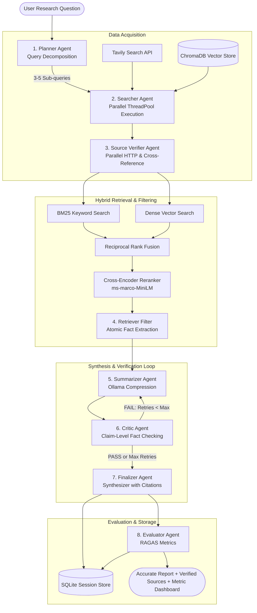

# 🧠 AI-Powered Multi-Agent Research & Decision Assistant

A production-grade, stateful multi-agent research and decision support system built with **LangChain**, **LangGraph**, **Ollama**, and **ChromaDB**. 

Rather than a simple conversational bot, this system executes an autonomous 8-stage research pipeline featuring query planning, parallel multi-source scouting, HTTP source verification, hybrid BM25 + vector retrieval, cross-encoder reranking, claim-level fact-checking with critique loops, and automated RAGAS-style evaluation.

---

## 🏗️ System Architecture



---

## 🤖 Independent Agent Responsibilities

| Agent | Responsibility | Implementation Details |
|---|---|---|
| **1. Planner** | Decomposes complex queries into 3–5 targeted sub-queries | JSON-mode Ollama prompt targeting diverse facets |
| **2. Searcher (Scout)** | Executes parallel searches across web and local vector storage | `ThreadPoolExecutor` parallel calls with fingerprint deduplication |
| **3. Source Verifier** | Verifies accessibility and cross-references facts against sources | Parallel HTTP HEAD requests + LLM cross-reference confidence scoring |
| **4. Retriever (Filter)** | Hybrid search, ranking, and fact extraction | BM25 + Vector search, Reciprocal Rank Fusion (RRF), Cross-Encoder reranking |
| **5. Summarizer** | Compresses heavy text into structured, coherent key findings | Context-aware summarization with critique feedback injection |
| **6. Critic (QC)** | Sentence-level claim checking and anti-hallucination guard | Evaluates each claim: `SUPPORTED`, `UNSUPPORTED`, or `CONTRADICTED` |
| **7. Finalizer** | Synthesizes polished decision report with inline citations | Markdown report with formal inline references (`[1]`, `[2]`) |
| **8. Evaluator** | Measures research quality using RAGAS-style metrics | Evaluates Faithfulness, Answer Relevancy, Precision, Recall, Coverage |

---

## 📊 Measurable Evaluation Metrics (RAGAS-Style)

Every completed research run is automatically evaluated across 5 quantitative dimensions:

1. **Faithfulness (35% weight)**: Proportion of claims in the final answer directly supported by retrieved context.
2. **Answer Relevancy (25% weight)**: Semantic alignment between the user's research question and the answer.
3. **Context Precision (20% weight)**: Ratio of retrieved document chunks that provided signal versus noise.
4. **Context Recall (15% weight)**: Degree to which retrieved context covered the required information.
5. **Source Coverage (5% weight)**: Verification rate of cited URLs and documents.

Scores are visualized via an interactive Plotly radar chart and historical trend graphs in the **Evaluation Dashboard**.

---

## 🚀 Quick Start

### Prerequisites
- Python 3.11+
- [Ollama](https://ollama.ai) installed and running locally (or via Docker)
- [Tavily API Key](https://tavily.com) (free tier available)

### 1. Installation
```bash
git clone <YOUR_REPOSITORY_URL>
cd "AI-Powered Multi-Agent Research & Decision Assistant"

# Create virtual environment
python -m venv venv
# On Windows:
.\venv\Scripts\activate
# On Linux/macOS:
source venv/bin/activate

# Install dependencies
pip install -r requirements.txt
```

### 2. Configure Environment
```bash
cp .env.example .env
```
Edit `.env`:
```ini
TAVILY_API_KEY=tvly-your-api-key
OLLAMA_BASE_URL=http://localhost:11434
OLLAMA_MODEL=llama3.2:3b
CHROMA_PERSIST_DIR=./data/chroma
DATABASE_URL=./data/sessions.db
MAX_RETRY=3
```

### 3. Pull Local LLM & Embedding Models
```bash
ollama pull llama3.2:3b
ollama pull nomic-embed-text
```

### 4. Run the Streamlit Application
```bash
streamlit run app/streamlit_app.py
```
Open **`http://localhost:8501`** in your browser.

### 5. Run FastAPI Endpoints (Optional)
```bash
uvicorn app.api:app --reload --port 8000
```
Interactive Swagger documentation available at **`http://localhost:8000/docs`**.

---

## 🐳 Docker & Docker Compose

Deploy the complete multi-container stack (Application + Ollama Sidecar + Model Preloader):

```bash
# Build and start services
docker-compose up --build

# Run in background
docker-compose up -d

# View logs
docker-compose logs -f

# Shutdown
docker-compose down
```

---

## 🧪 Testing & Verification

Run the test suite (35+ unit and integration tests covering agents, reranking, BM25, and graph execution):

```bash
pytest tests/ -v --tb=short
```

---

## ☁️ Deployment Guide

### GitHub Setup & Push
```bash
# Set your remote repository
git remote add origin https://github.com/<your-username>/<your-repo-name>.git

# Push code to main
git branch -M main
git push -u origin main
```

### Automated CI/CD (GitHub Actions)
The included `.github/workflows/deploy.yml` workflow automatically runs on every push:
1. **Lint**: Validates formatting with `ruff` and `black`.
2. **Test**: Executes test suite with `pytest`.
3. **Build & Package**: Builds Docker container and publishes to GitHub Container Registry (`ghcr.io`).
4. **Deploy**: Triggers automatic deployment to Railway or Render.

### Deployment Targets
- **Railway**: Connect your GitHub repository. The included `railway.json` and `Dockerfile` configure build settings automatically. Set `TAVILY_API_KEY` in Railway dashboard.
- **Render**: Connect repository using `render.yaml`. Set environment variables in the Render dashboard.

---

## 📂 Project Structure

```
├── app/
│   ├── api.py                  # FastAPI REST endpoints (/research, /sessions)
│   └── streamlit_app.py        # 4-tab UI (Research, Evaluation, KB, History)
├── src/
│   ├── agents/
│   │   ├── planner.py          # 1. Query decomposition
│   │   ├── searcher.py         # 2. Parallel multi-source scouting
│   │   ├── source_verifier.py  # 3. HTTP HEAD checks & claim cross-ref
│   │   ├── retriever.py        # 4. Hybrid BM25+Vector + RRF + Fact extraction
│   │   ├── summarizer.py       # 5. Ollama compression with critique memory
│   │   ├── critic.py           # 6. Sentence-level anti-hallucination QC
│   │   └── finalizer.py        # 7. Synthesis with citations & SQLite save
│   ├── evaluation.py           # 8. RAGAS evaluation metrics
│   ├── reranker.py             # Cross-encoder reranker (sentence-transformers)
│   ├── document_pipeline.py    # Ingestion for PDF, DOCX, TXT, MD
│   ├── vectorstore.py          # ChromaDB integration with Ollama embeddings
│   ├── tools.py                # Tavily search & vector retrieval wrappers
│   ├── database.py             # SQLite persistence & analytics
│   ├── state.py                # LangGraph TypedDict shared state
│   └── config.py               # Pydantic settings management
├── tests/
│   └── test_graph.py           # Test suite (unit + pipeline integration)
├── .github/workflows/
│   └── deploy.yml              # CI/CD pipeline
├── Dockerfile                  # Multi-stage container build
├── docker-compose.yml          # Container orchestration with Ollama sidecar
├── railway.json                # Railway deployment manifest
├── render.yaml                 # Render deployment blueprint
├── requirements.txt            # Python dependencies
└── README.md
```

---

## 📜 License
MIT License.
